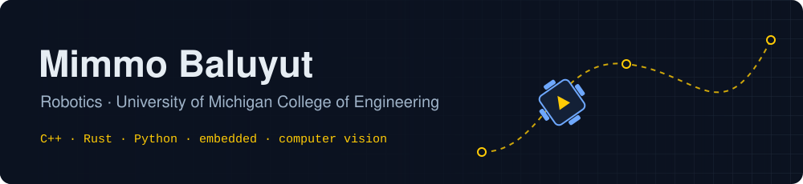

  <a href="mailto:mimmo@umich.edu">mimmo@umich.edu</a> ·
  <a href="https://www.linkedin.com/in/mimmo-baluyut-816612399/">LinkedIn</a> ·
  Ann Arbor, MI / New York, NY ·
  <b>Open to Summer 2027 internships</b>

<table>
<tr>
<td width="33%" valign="top">

#### 🤖 Robot software
- **MARC**: C++ drivetrain control for a 4-omniwheel holonomic drive
- **MAAV**: OpenCV object detection on NVIDIA Jetson for in-flight obstacle avoidance
- **FTC**: lead software developer, Nest+m Robotics, 2024–25

</td>
<td width="33%" valign="top">

#### 🔌 Embedded & hardware
- [**star-destroyer**](https://github.com/Mimmob07/star-destroyer): Rust web server on an ESP32 that drives LEDs
- [**Sweep-KB**](https://github.com/Mimmob07/Sweep-KB): my build of the Ferris Sweep split keyboard, [ZMK firmware config](https://github.com/Mimmob07/zmk-config)
- Model rockets designed in OpenRocket, Toulouse 2024

</td>
<td width="33%" valign="top">

#### 🛠️ Systems & tools
- [**iPod Connection Utility**](https://github.com/Mimmob07/ipod_connection_utility): 8K lines of Rust, ARM64 Linux releases, 200 tests
- [**Slides to reMarkable**](https://github.com/Mimmob07/slides-to-remarkable-public): CI pipeline turning lecture slides into circuit worksheets
- [**Neural-network**](https://github.com/Mimmob07/Neural-network): MNIST net and linear algebra library from scratch in Rust

</td>
</tr>
</table>

**Toolbox:** `C++` `Rust` `Python` `C` `Go` · `Linux` `NVIDIA Jetson` `ESP32` `Raspberry Pi` `Arduino` · `OpenCV` `NumPy` `SciPy` `GitHub Actions`

B.S.E. (intended Robotics), University of Michigan, May 2029 · GPA 3.87 · Dean's List · Branstrom Freshman Prize
